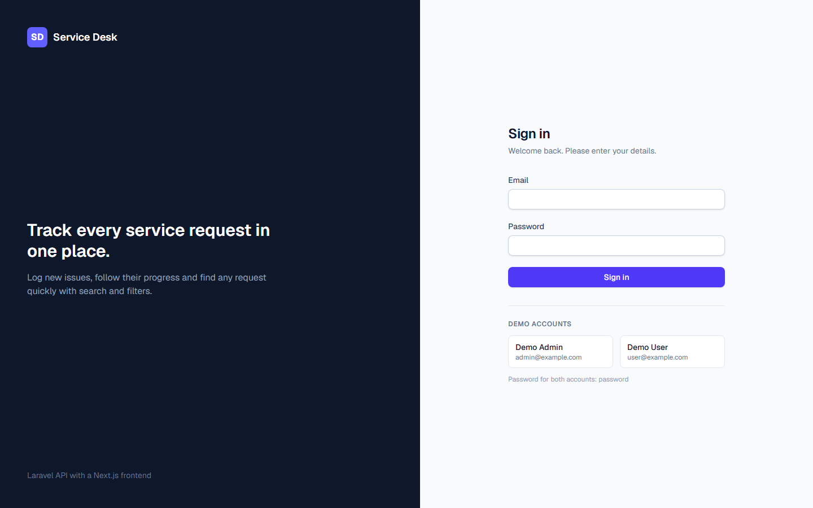
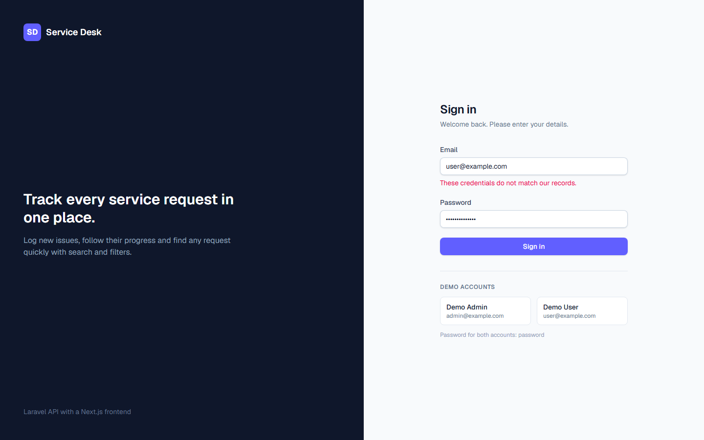
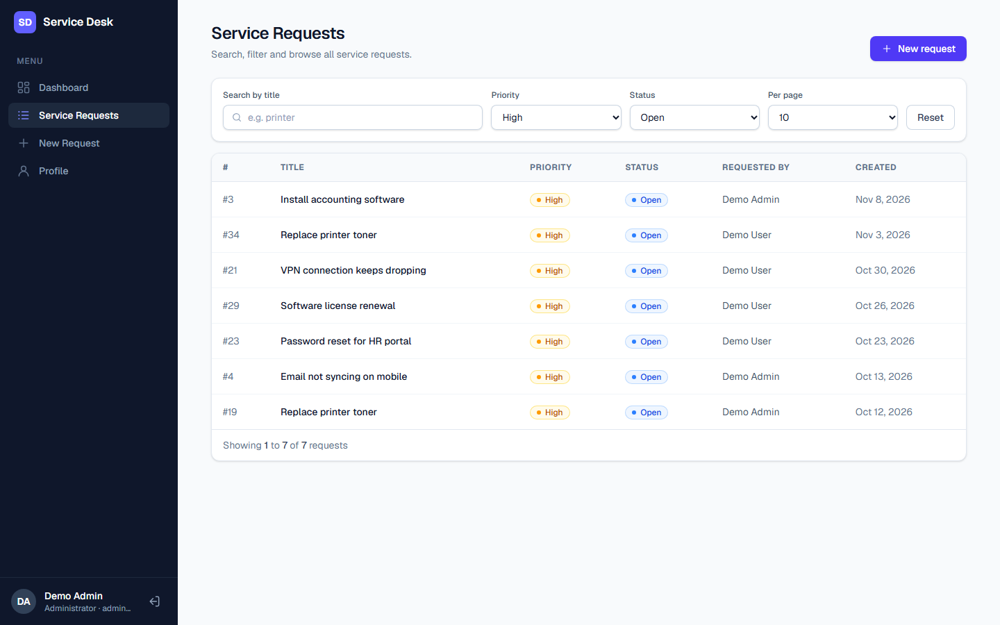
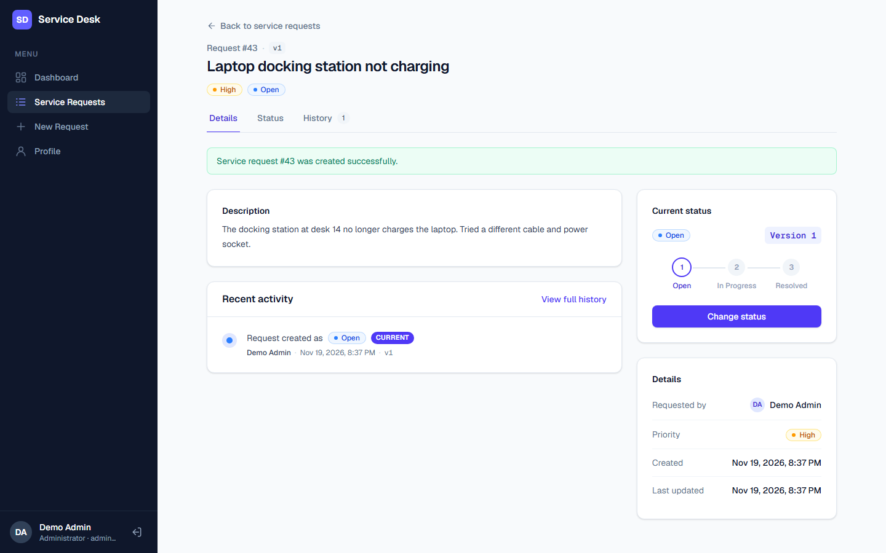
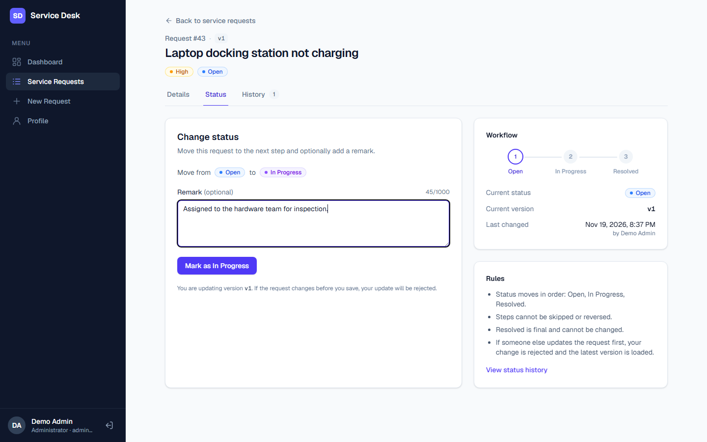
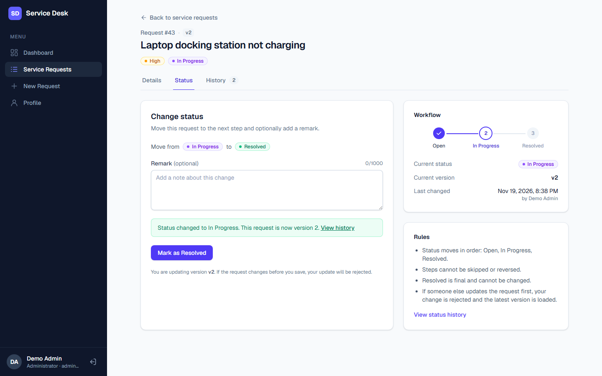
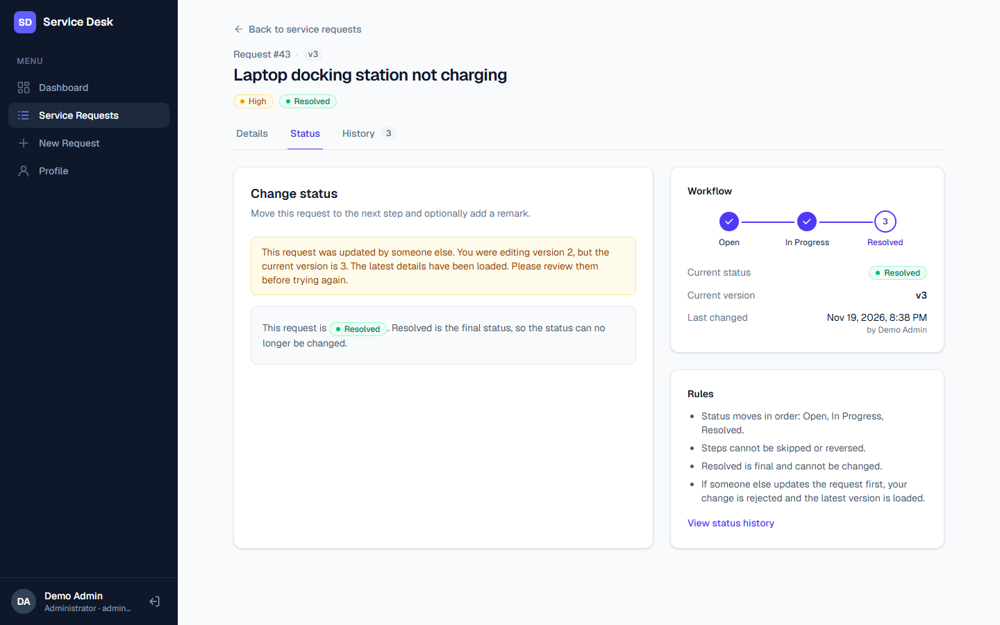

# Service Request Management

A service desk application for logging, tracking and resolving service requests.

- **Backend:** Laravel 13 REST API with Laravel Sanctum token authentication
- **Frontend:** Next.js 16 (App Router, React 19, TypeScript, Tailwind CSS 4) in [`frontend/`](frontend/)
- **Database:** SQLite by default, MySQL or PostgreSQL also supported

## Features

- Login, logout and current user profile with two seeded demo accounts
- Create service requests, view details, search by title, filter by priority and status, server-side pagination
- Status workflow `OPEN → IN_PROGRESS → RESOLVED` with an optional remark on each change
- Audit history: every successful status change creates exactly one history record
- Optimistic concurrency control: every request has a version, and an outdated version can never overwrite newer data
- Access control: members only see and manage their own requests, administrators manage all requests

## Project structure

```
app/
  Actions/ChangeServiceRequestStatus.php   status change in a transaction with version check
  Enums/                                   priority and status enums, workflow rules
  Exceptions/                              invalid transition (422) and stale version (409)
  Http/Controllers/Api/                    auth and service request endpoints
  Http/Requests/                           validation
  Http/Resources/                          JSON responses
  Models/                                  User, ServiceRequest, ServiceRequestStatusHistory
  Policies/ServiceRequestPolicy.php        owner or admin access
database/
  factories/  migrations/  seeders/
tests/Feature/                             automated Laravel tests
frontend/                                  Next.js application
docs/screenshots/                          screenshots used below
```

## Requirements

- PHP 8.3 or newer with the `pdo_sqlite` extension (or `pdo_mysql` / `pdo_pgsql`)
- Composer 2
- Node.js 20.9 or newer and npm

## Installation

### 1. Backend (Laravel API)

```bash
git clone https://github.com/GHLakshani/lalan-test.git
cd lalan-test

composer install
cp .env.example .env
php artisan key:generate
```

The default database is SQLite. Create the database file, then run the migrations and seeders:

```bash
touch database/database.sqlite
php artisan migrate --seed
```

To use MySQL instead, update these values in `.env` before migrating:

```dotenv
DB_CONNECTION=mysql
DB_HOST=127.0.0.1
DB_PORT=3306
DB_DATABASE=service_requests
DB_USERNAME=root
DB_PASSWORD=
```

Start the API:

```bash
php artisan serve
```

The API is now available at `http://localhost:8000/api`.

**Running under WAMP or XAMPP:** the project root contains an `.htaccess` and `index.php` that forward requests to `public/`, so the project can also be opened from a web server sub-folder, for example `http://localhost/lalan-test`. The API is then available at `http://localhost/lalan-test/api`.

### 2. Frontend (Next.js)

```bash
cd frontend
cp .env.example .env.local
npm install
```

Set `NEXT_PUBLIC_API_URL` in `frontend/.env.local` to the API address:

```dotenv
NEXT_PUBLIC_API_URL=http://localhost:8000/api
```

Use `http://localhost/lalan-test/api` when the backend runs under WAMP. Then start the frontend:

```bash
npm run dev
```

Open `http://localhost:3000`.

For a production build use `npm run build` followed by `npm run start`.

### Demo accounts

| Account    | Email               | Password   | Access                        |
|------------|---------------------|------------|-------------------------------|
| Demo Admin | `admin@example.com` | `password` | All service requests          |
| Demo User  | `user@example.com`  | `password` | Only their own requests       |

The seeders create 20 requests for each account. Each request moves through the workflow with realistic status history, remarks and versions.

To reset the demo data:

```bash
php artisan migrate:fresh --seed
```

## API

All endpoints return JSON. Send `Accept: application/json`, and `Authorization: Bearer <token>` for protected endpoints.

| Method  | Endpoint                              | Description                                                         |
|---------|---------------------------------------|---------------------------------------------------------------------|
| `POST`  | `/api/login`                          | Returns a token and the user. Rate limited to 6 attempts per minute |
| `POST`  | `/api/logout`                         | Revokes the current token                                           |
| `GET`   | `/api/me`                             | Current user profile                                                |
| `GET`   | `/api/service-requests`               | List with `search`, `priority`, `status`, `per_page`, `page`        |
| `POST`  | `/api/service-requests`               | Create a request (`title`, `description`, `priority`)               |
| `GET`   | `/api/service-requests/{id}`          | Request details with version and status history                     |
| `PATCH` | `/api/service-requests/{id}/status`   | Change status (`status`, `version`, optional `remark`)              |

Responses for errors:

| Status | Meaning                                                                 |
|--------|-------------------------------------------------------------------------|
| `401`  | Missing or invalid token                                                |
| `403`  | The request belongs to another user                                     |
| `404`  | The request does not exist                                              |
| `409`  | Stale version. The response includes `current_version` and the latest `data` |
| `422`  | Validation error or invalid status transition                           |

## Business rules

**Workflow.** Status can only move one step forward: `open → in_progress → resolved`. Skipping a step, moving backwards, setting the same status again, or changing a resolved request returns `422` with a clear message.

**Audit history.** Creating a request records the initial status. Each successful status change records the previous status, new status, new version, remark, user and time. Failed changes record nothing.

**Concurrency control.** The client sends the `version` it last saw. `ChangeServiceRequestStatus` runs inside a database transaction:

1. Lock the row with `lockForUpdate()` and compare versions. A mismatch returns `409`.
2. Validate the transition. An invalid transition returns `422`.
3. Update with `WHERE id = ? AND version = ?` and increment the version. If no row is updated, another change won the race and `409` is returned.
4. Insert the history record. If this fails, the whole transaction is rolled back.

Direct changes to `status` on the model are blocked, so all status changes go through these rules.

## Running the tests

Backend tests (PHPUnit, in-memory SQLite, no setup needed):

```bash
php artisan test
```

Run a single test file or test:

```bash
php artisan test tests/Feature/ServiceRequestStatusTest.php
php artisan test --filter=test_outdated_version_is_rejected_with_conflict
```

Frontend checks:

```bash
cd frontend
npm run lint
npm run build
```

### Required test cases

The suite contains 66 tests. The required scenarios are covered by:

| Requirement | Tests |
|-------------|-------|
| 1. Successful login and unauthenticated access rejection | `AuthTest::test_user_can_login_with_valid_credentials`, `AuthTest::test_guest_cannot_view_profile`, `ServiceRequestTest::test_guest_cannot_access_service_requests` |
| 2. Preventing users from accessing other users' requests | `ServiceRequestAuthorizationTest::test_user_cannot_view_another_users_request`, `test_user_cannot_change_status_of_another_users_request`, `test_user_only_sees_own_requests_in_the_list` |
| 3. Successful request creation and invalid input validation | `ServiceRequestTest::test_user_can_create_service_request`, `ServiceRequestTest::test_create_validates_input` |
| 4. Successful status transition, version increment and history creation | `ServiceRequestStatusTest::test_status_moves_from_open_to_in_progress`, `test_each_successful_change_creates_exactly_one_history_record` |
| 5. Invalid status transition rejection | `ServiceRequestStatusTest::test_invalid_status_changes_are_rejected` (7 cases: skipping, reversing, repeating and changing after resolved) |
| 6. Stale version update rejection without overwriting newer data | `ServiceRequestStatusTest::test_outdated_version_is_rejected_with_conflict`, `test_two_users_with_the_same_version_only_first_wins`, `test_conditional_update_detects_a_change_made_after_the_version_check` |

## Screenshots

### Login

| Login | Validation error |
|-------|------------------|
|  |  |

### Request workflow

| Dashboard | Search and filters |
|-----------|--------------------|
|  |  |

| Create request with validation errors | Request details |
|---------------------------------------|-----------------|
|  |  |

| Status management | Status changed |
|-------------------|----------------|
|  |  |

| Stale update rejected | Status history |
|-----------------------|----------------|
|  |  |

| Not found | Mobile dashboard | Mobile menu |
|-----------|------------------|-------------|
|  |  |  |

## AI Use & Verification

### AI tools used

- Claude (Anthropic), used through Claude Code in VS Code.

### Parts of the project AI helped with

- **Next.js frontend development:** the screens in `frontend/` (login, dashboard, service request list, create request, request details, status management, history and profile), the sidebar layout, the API client, the authentication context, data loading hooks, and handling of loading, empty, validation, authorization, API failure and stale update states.
- **Test data:** the model factories and seeders that create the demo accounts and 40 demo requests with realistic titles, status histories, remarks and versions.
- **Documentation:** generating this README.

**Laravel backend:**

> _To be completed by the author._

### Example prompt

> "Now for the ServiceRequest Controller Functions I need a view from Next.js and Need a side bar menu."

This was followed by "note need a dashboard view when loading", which led to the dashboard being the first screen after login and to the layout rendering the sidebar with loading placeholders instead of a blank spinner.

### How the generated code was verified and corrected

- Every change was checked with `npm run lint`, a TypeScript check and `npm run build`.
- Each screen was tested against the running API, including `401`, `403`, `404`, `409` and `422` responses.
- The Next.js development server reported that pages could not be validated for instant navigation, because the generated layout replaced the whole page with a spinner while authentication loaded. The layout was changed to always render the sidebar and page shell with loading placeholders.
- The development server also reported that `usePathname()` was used outside a `<Suspense>` boundary on the request pages. The sidebar links were moved into their own component inside `<Suspense>`.
- The screenshots in this README were reviewed and showed two layout problems: the workflow stepper connector extended past the last step, and the dashboard cards were cramped on mobile. Both were fixed before the final screenshots were taken.
- The seeded data is checked by `ServiceRequestHistoryTest::test_seeded_requests_have_consistent_history`, which confirms that every seeded request has a complete history, sequential versions and only valid transitions.
- `next dev` automatically generates an `AGENTS.md` file when it detects an AI coding tool. This file was removed and is not part of the repository.

### One technical decision made independently

> _To be completed by the author._
