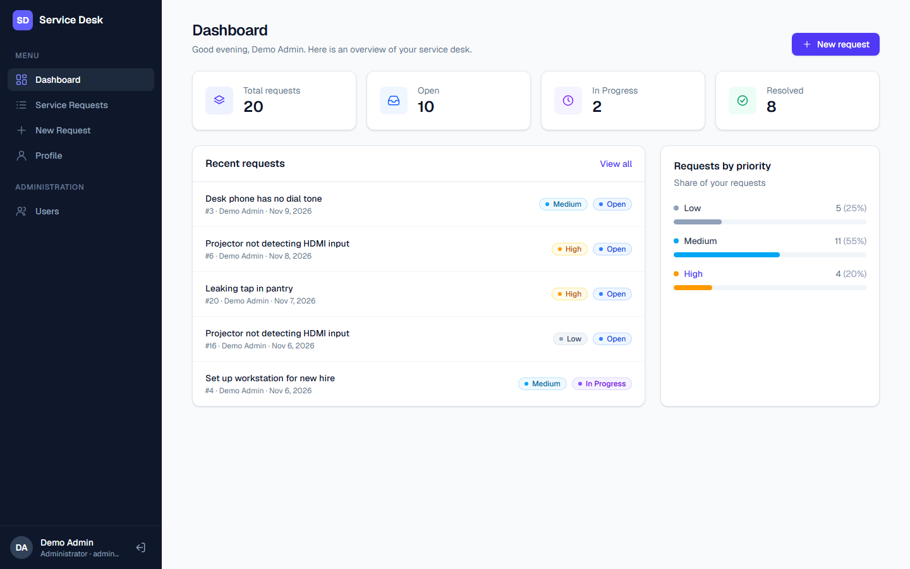
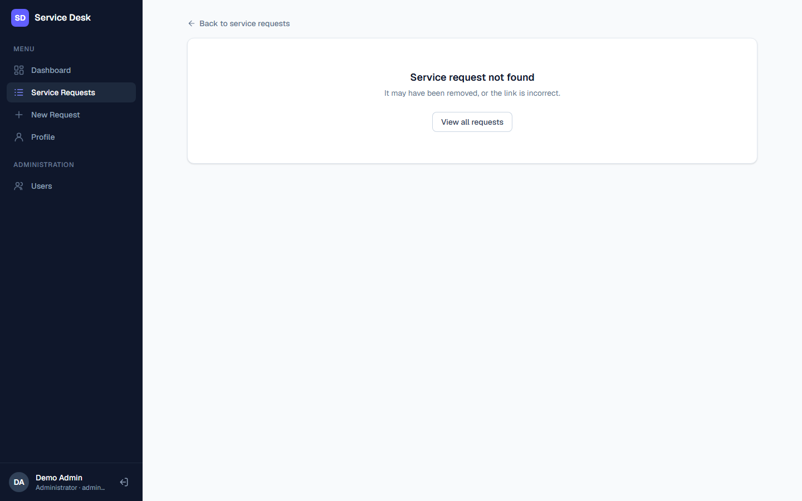
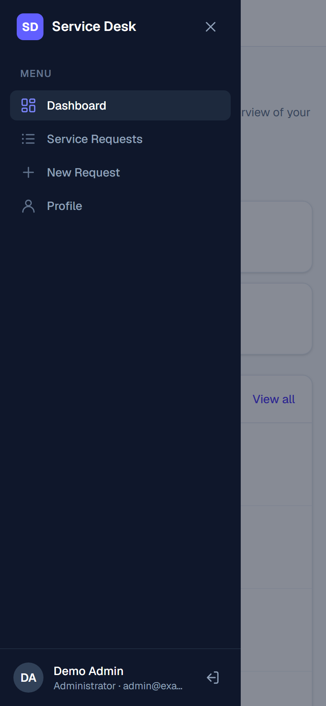
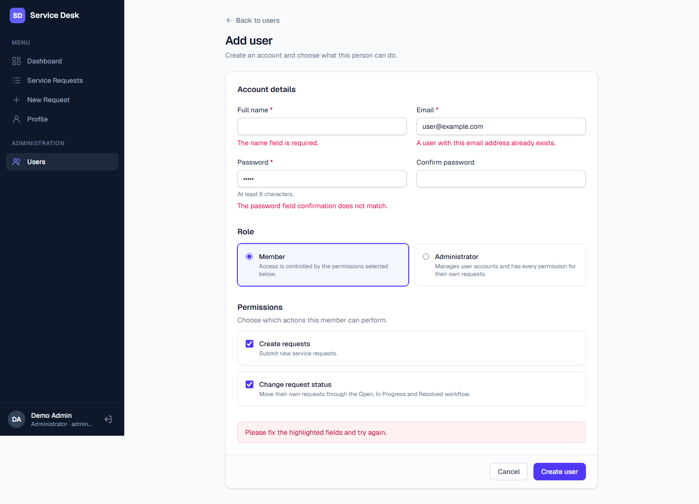
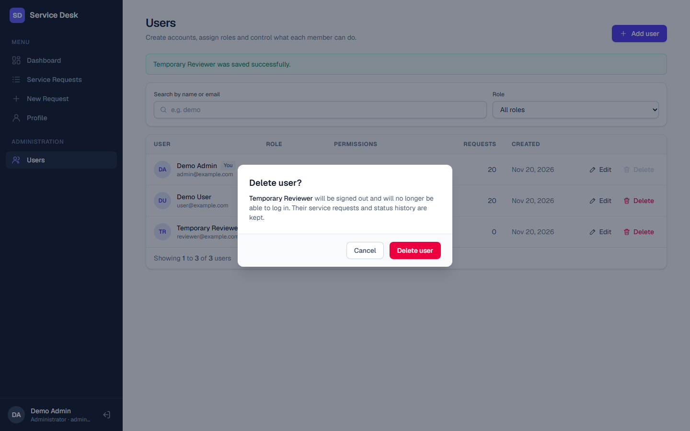
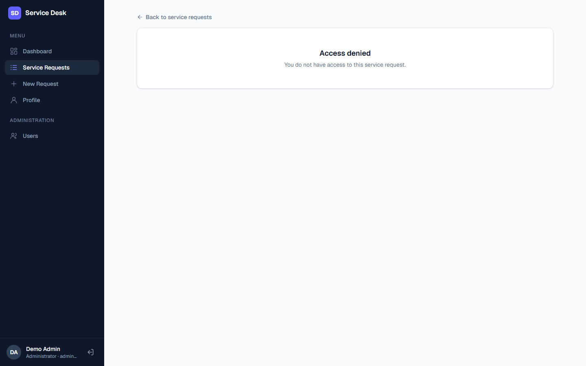

# Service Request Management

A compact, secure service request tracker. Employees sign in, raise service requests, move them through a controlled workflow and see a full audit trail of every status change.

- **Backend:** Laravel 13 REST API with Laravel Sanctum API tokens
- **Frontend:** Next.js 16 (App Router, React 19, TypeScript, Tailwind CSS 4) in [`frontend/`](frontend/)
- **Database:** SQLite by default, MySQL or PostgreSQL also supported

## Features

- Login, logout and current user (`/me`) with two seeded demo accounts
- Create service requests, view details, search by title, combined priority and status filters, server-side pagination
- Status workflow `OPEN → IN_PROGRESS → RESOLVED` with an optional remark on each change
- Audit history: every successful status change creates exactly one history record, available through its own endpoint
- Optimistic concurrency control: every request has a version, and a stale `expected_version` can never overwrite newer data
- Strict ownership: every user, including administrators, can only read and change their own requests and status history
- User management for administrators: create, edit and delete users and assign roles and permissions

## Project structure

The repository root is the Laravel backend. The Next.js frontend is in `frontend/`.

```
app/
  Actions/ChangeServiceRequestStatus.php   status change in a transaction with version check
  Enums/                                   priority, status and permission enums, workflow rules
  Exceptions/                              invalid transition and stale version (both 409)
  Http/Controllers/Api/                    auth, request and user endpoints
  Http/Requests/                           validation
  Http/Resources/                          JSON responses
  Models/                                  User, ServiceRequest, ServiceRequestStatusHistory
  Policies/                                request ownership and user management rules
database/
  factories/  migrations/  seeders/
routes/api.php                             API routes
tests/Feature/                             automated Laravel tests
frontend/                                  Next.js application
docs/screenshots/                          screenshots used below
```

## Requirements

- PHP 8.3 or newer with the `pdo_sqlite` extension (or `pdo_mysql` / `pdo_pgsql`)
- Composer 2
- Node.js 20.9 or newer and npm

No paid services are needed.

## Installation

### 1. Backend (Laravel API)

```bash
git clone https://github.com/GHLakshani/lalan-test.git
cd lalan-test

composer install
cp .env.example .env
php artisan key:generate
```

The default database is SQLite. Create the database file, then run the migrations and seeders:

```bash
touch database/database.sqlite
php artisan migrate --seed
```

To use MySQL instead, update these values in `.env` before migrating:

```dotenv
DB_CONNECTION=mysql
DB_HOST=127.0.0.1
DB_PORT=3306
DB_DATABASE=service_requests
DB_USERNAME=root
DB_PASSWORD=
```

Start the API:

```bash
php artisan serve
```

The API is now available at `http://localhost:8000/api`.

**Running under WAMP or XAMPP:** the project root contains an `.htaccess` and `index.php` that forward requests to `public/`, so the project can also be opened from a web server sub-folder, for example `http://localhost/lalan-test`. The API is then available at `http://localhost/lalan-test/api`.

### 2. Frontend (Next.js)

```bash
cd frontend
cp .env.example .env.local
npm install
```

Set `NEXT_PUBLIC_API_URL` in `frontend/.env.local` to the API address:

```dotenv
NEXT_PUBLIC_API_URL=http://localhost:8000/api
```

Use `http://localhost/lalan-test/api` when the backend runs under WAMP. Then start the frontend:

```bash
npm run dev
```

Open `http://localhost:3000`.

For a production build use `npm run build` followed by `npm run start`.

### Environment variables

Both `.env.example` files contain no real secrets. The values that matter for this project are:

| Variable              | Where              | Purpose                                              |
|-----------------------|--------------------|------------------------------------------------------|
| `APP_KEY`             | `.env`             | Generated by `php artisan key:generate`              |
| `DB_*`                | `.env`             | Database connection                                  |
| `SANCTUM_EXPIRATION`  | `.env`             | API token lifetime in minutes, default `480` (8 hours) |
| `NEXT_PUBLIC_API_URL` | `frontend/.env.local` | Base URL of the Laravel API                       |

### Demo accounts

| Account    | Email               | Password   | Role          | Access                                    |
|------------|---------------------|------------|---------------|-------------------------------------------|
| Demo Admin | `admin@example.com` | `password` | Administrator | Own requests, plus user management        |
| Demo User  | `user@example.com`  | `password` | Member        | Own requests: create and change status    |

The seeders create 20 requests for each account. Each request moves through the workflow with realistic status history, remarks and versions, and every status change is made by the request's owner. Signing in as one account never shows the other account's requests.

To reset the demo data:

```bash
php artisan migrate:fresh --seed
```

## Authentication

**Choice: Laravel Sanctum API tokens.** The Next.js frontend runs on its own origin (`http://localhost:3000`) and the API runs on another (`http://localhost:8000` or a WAMP sub-folder). Bearer tokens work across these origins without cookie domain, same-site or CSRF configuration, and the same API can be used from tools such as Postman. Sanctum is first-party Laravel, so there is no third-party JWT library to configure.

- `POST /api/auth/login` checks the credentials and returns a plain-text token. Only a SHA-256 hash of the token is stored in the database. Login is rate limited to 6 attempts per minute.
- `GET /api/auth/me` returns the signed-in user, or `401` without a valid token.
- `POST /api/auth/logout` deletes the current token on the server, so it stops working immediately.
- Tokens expire after `SANCTUM_EXPIRATION` minutes (8 hours by default). Expired tokens are rejected with `401` and removed by a daily `sanctum:prune-expired` schedule.
- Passwords are hashed with bcrypt through the `hashed` cast on the `User` model.

**Token storage trade-off.** The frontend keeps the token in `localStorage` and sends it as an `Authorization: Bearer` header. This is simple and works across origins, but any script running on the page could read the token, so it depends on the app being free of XSS. The risk is reduced because React escapes all rendered output, no raw HTML is injected, tokens expire after 8 hours and logout revokes the token on the server. The alternative, Sanctum's cookie-based SPA mode with `HttpOnly` cookies, keeps the token out of JavaScript but needs both apps on the same top-level domain plus CSRF and same-site configuration. That trade-off was not worth it for a local two-origin setup.

## Data model

| Table                      | Columns                                                                                          |
|----------------------------|--------------------------------------------------------------------------------------------------|
| `users`                    | Laravel users, plus `is_admin`, `permissions` (JSON) and `deleted_at` for soft deletes           |
| `service_requests`         | `id`, `created_by` (FK users), `title` (3–100), `description` (10–500), `priority` (`LOW`/`MEDIUM`/`HIGH`), `status` (`OPEN`/`IN_PROGRESS`/`RESOLVED`, default `OPEN`), `version` (default 1), timestamps |
| `request_status_histories` | `id`, `service_request_id` (FK), `actor_user_id` (FK users), `from_status` (null for the initial record), `to_status`, `version`, `remark` (nullable), `created_at` |

Foreign keys enforce the relationships. Indexes cover `(created_by, created_at)` for "my requests, newest first", `status`, `priority`, `title` for search, and `(service_request_id, created_at)` for the history.

Two additions to the minimum schema:

- `request_status_histories.version` records which version each change produced, which makes the audit trail easy to check against the request.
- An initial history record (`from_status` is `null`) is written when a request is created, so the trail always starts at `OPEN`.

## API

All endpoints return JSON. Send `Accept: application/json`, and `Authorization: Bearer <token>` for protected endpoints.

| Method   | Endpoint                         | Description                                                                 |
|----------|----------------------------------|-----------------------------------------------------------------------------|
| `POST`   | `/api/auth/login`                | `email`, `password`. Returns `token`, `token_type` and `user`               |
| `GET`    | `/api/auth/me`                   | Current user                                                                |
| `POST`   | `/api/auth/logout`               | Revokes the current token                                                   |
| `GET`    | `/api/requests`                  | Own requests, newest first. `search`, `status`, `priority`, `per_page` (default 10, max 25), `page` |
| `POST`   | `/api/requests`                  | Create a request: `title`, `description`, `priority`                        |
| `GET`    | `/api/requests/{id}`             | Request detail with current `version`                                       |
| `PATCH`  | `/api/requests/{id}/status`      | `status`, `expected_version`, optional `remark`                             |
| `GET`    | `/api/requests/{id}/history`     | Status audit trail, oldest first                                            |
| `GET`    | `/api/permissions`               | Available member permissions                                                |
| `GET`    | `/api/users`                     | Admin only. `search`, `role`, `per_page`, `page`                            |
| `POST`   | `/api/users`                     | Admin only. `name`, `email`, `password`, `password_confirmation`, `role`, `permissions` |
| `GET`    | `/api/users/{id}`                | Admin only                                                                  |
| `PUT`    | `/api/users/{id}`                | Admin only. `password` is optional                                          |
| `DELETE` | `/api/users/{id}`                | Admin only. Soft delete                                                     |

`created_by`, `status` and `version` are never taken from the client when creating a request. New requests always start as `OPEN` at version 1.

### Example requests

```http
POST /api/requests
{"title":"Printer not working","description":"Office printer stopped responding.","priority":"HIGH"}

PATCH /api/requests/12/status
{"status":"IN_PROGRESS","expected_version":1,"remark":"Technician assigned"}
```

### Response shape

Single records use Laravel's resource envelope:

```json
{
  "data": {
    "id": 12,
    "title": "Printer not working",
    "description": "Office printer stopped responding.",
    "priority": { "value": "HIGH", "label": "High" },
    "status": { "value": "IN_PROGRESS", "label": "In Progress" },
    "next_status": { "value": "RESOLVED", "label": "Resolved" },
    "version": 2,
    "requested_by": { "id": 2, "name": "Demo User" },
    "status_history": [
      {
        "id": 31,
        "from_status": { "value": "OPEN", "label": "Open" },
        "to_status": { "value": "IN_PROGRESS", "label": "In Progress" },
        "version": 2,
        "remark": "Technician assigned",
        "actor": { "id": 2, "name": "Demo User" },
        "created_at": "2026-11-20T09:15:00.000000Z"
      }
    ],
    "created_at": "2026-11-20T09:00:00.000000Z",
    "updated_at": "2026-11-20T09:15:00.000000Z"
  }
}
```

The list endpoint returns `data`, `links` and `meta` (`current_page`, `per_page`, `total`, `last_page`, `from`, `to`). The history endpoint returns `data` as an array of history entries in chronological order. `status_history` is included in the detail and status change responses only.

### Errors

Errors always contain a readable `message`. Validation and transition errors also contain an `errors` object keyed by field.

```json
{
  "message": "Cannot change status from Open to Resolved. The next allowed status is In Progress.",
  "errors": { "status": ["Cannot change status from Open to Resolved. The next allowed status is In Progress."] }
}
```

| Status | Meaning                                                                                       |
|--------|-----------------------------------------------------------------------------------------------|
| `401`  | Missing, invalid, revoked or expired token                                                    |
| `403`  | Another user's request or history, a missing permission, or a non-admin managing users        |
| `404`  | Unknown request or user                                                                       |
| `409`  | Invalid status transition, or stale `expected_version`. Stale responses also include `current_version` and the latest `data` |
| `422`  | Malformed or invalid fields                                                                   |

**Non-owned records return `403`.** This is applied consistently to the detail, status change and history endpoints. Other users' requests never appear in the list.

## Business rules

**Workflow.** Status can only move one step forward: `OPEN → IN_PROGRESS → RESOLVED`. Skipping a step, moving backwards, repeating the current status, or changing a resolved request returns `409` with a clear message and changes nothing.

**Audit history.** Each successful status change writes exactly one history record with the previous status, new status, new version, remark, actor and time. Failed changes write nothing.

**Concurrency control.** The client sends the `expected_version` it last saw. `ChangeServiceRequestStatus` runs inside a single database transaction:

1. Lock the row with `lockForUpdate()` and compare `expected_version` with the current version. A mismatch returns `409`.
2. Validate the transition. An invalid transition returns `409`.
3. Update with `WHERE id = ? AND version = ?` and increment the version by 1. If no row is updated, another change won the race and `409` is returned.
4. Insert the history record. If this fails, the whole transaction is rolled back, so the status and version are not changed either.

Direct changes to `status` on the model are blocked, so every status change goes through these rules.

## Ownership, roles and permissions

**Ownership comes first.** A service request can only be listed, read or changed by the user who created it. This applies to every role, including administrators. Requests from other users never appear in lists or searches, and opening, changing or reading the history of one returns `403` with `You do not have access to this service request.`

There are two roles:

- **Administrator:** manages user accounts and has every permission for their own requests.
- **Member:** can only perform the actions an administrator has granted, and only on their own requests.

| Permission               | Allows                                         |
|--------------------------|------------------------------------------------|
| `requests.create`        | Creating service requests                      |
| `requests.change_status` | Changing the status of their own requests      |

New members get both permissions by default. Permissions are checked on every API call, so changes take effect immediately. Permissions only restrict what users can do with their own requests; they never grant access to someone else's. The frontend hides actions the signed-in user is not allowed to perform, and the API enforces the same rules with `403` responses.

User management rules:

- Administrators cannot delete their own account or remove their own administrator role, so the system always keeps at least one administrator.
- Deleting a user is a soft delete. Their tokens are revoked and they can no longer sign in, but their service requests and status history are kept for auditing.

## Running the tests

Backend tests (PHPUnit, in-memory SQLite, no setup needed):

```bash
php artisan test
```

Run a single test file or test:

```bash
php artisan test tests/Feature/ServiceRequestStatusTest.php
php artisan test --filter=test_outdated_version_is_rejected_with_conflict
```

Frontend checks:

```bash
cd frontend
npm run lint
npm run build
```

### Required test cases

The suite contains 84 tests. The required scenarios are covered by:

| Requirement | Tests |
|-------------|-------|
| 1. Successful sign-in and unauthenticated rejection (401) | `AuthTest::test_user_can_login_with_valid_credentials`, `AuthTest::test_guest_cannot_view_profile`, `ServiceRequestTest::test_guest_cannot_access_service_requests`, `AuthTest::test_tokens_expire_after_the_configured_lifetime` |
| 2. Cross-user request, detail and history access is blocked | `ServiceRequestAuthorizationTest::test_user_cannot_view_another_users_request`, `test_user_cannot_read_another_users_status_history`, `test_user_cannot_change_status_of_another_users_request`, `test_user_only_sees_own_requests_in_the_list`, `test_admin_cannot_read_or_change_other_users_requests` |
| 3. Request creation success and invalid input (422) | `ServiceRequestTest::test_user_can_create_service_request`, `test_create_validates_input`, `test_create_enforces_title_and_description_lengths`, `test_priority_values_follow_the_contract` |
| 4. A valid transition persists, increments the version and creates one history record | `ServiceRequestStatusTest::test_status_moves_from_open_to_in_progress`, `test_each_successful_change_creates_exactly_one_history_record` |
| 5. An invalid transition returns 409 and does not modify the request or history | `ServiceRequestStatusTest::test_invalid_status_changes_are_rejected` (7 cases: skipping, reversing, repeating and changing after resolved) |
| 6. A stale `expected_version` returns 409 without overwriting the latest state | `ServiceRequestStatusTest::test_outdated_version_is_rejected_with_conflict`, `test_two_sessions_with_the_same_version_only_first_wins`, `test_conditional_update_detects_a_change_made_after_the_version_check` |

Other coverage includes the history endpoint (`ServiceRequestHistoryTest`), the transaction rollback when the history cannot be saved, user management (`UserManagementTest`) and permissions (`PermissionTest`).

## Screenshots

### Login

| Login | Validation error |
|-------|------------------|
|  |  |

### Request workflow

| Dashboard | Search and filters |
|-----------|--------------------|
|  |  |

| Create request with validation errors | Request details |
|---------------------------------------|-----------------|
|  |  |

| Status management | Status changed |
|-------------------|----------------|
|  |  |

| Stale update rejected | Status history |
|-----------------------|----------------|
|  |  |

| Not found | Mobile dashboard | Mobile menu |
|-----------|------------------|-------------|
|  |  |  |

### User management and access control

| Users | Add user |
|-------|----------|
|  |  |

| Add user validation | Delete user |
|---------------------|-------------|
|  |  |

| Administrator opening another user's request |
|----------------------------------------------|
|  |

## AI Use & Verification

### AI tools used

- Claude (Anthropic), used through Claude Code in VS Code.

### Parts of the project AI helped with

- **Next.js frontend development:** the screens in `frontend/` (login, dashboard, service request list, create request, request details, status management, history, profile and user management), the sidebar layout, permission-based hiding of actions, the API client, the authentication context, data loading hooks, and handling of loading, empty, validation, authorization, API failure and stale update states.
- **Test data:** the model factories and seeders that create the two demo accounts with their roles and permissions, and 40 demo requests with realistic titles, status histories, remarks and versions.
- **Documentation:** generating this README.

### Example prompt

> "For the ServiceRequest Controller Functions I need a view from Next.js and Need a side bar menu."

This was followed by "note need a dashboard view when loading", which led to the dashboard being the first screen after login and to the layout rendering the sidebar with loading placeholders instead of a blank spinner.

### How the generated code was verified and corrected

- Every change was checked with `npm run lint`, a TypeScript check and `npm run build`.
- Each screen was tested against the running API, including `401`, `403`, `404`, `409` and `422` responses.
- The Next.js development server reported that pages could not be validated for instant navigation, because the generated layout replaced the whole page with a spinner while authentication loaded. The layout was changed to always render the sidebar and page shell with loading placeholders.
- The development server also reported that `usePathname()` was used outside a `<Suspense>` boundary on the request pages. The sidebar links were moved into their own component inside `<Suspense>`.
- The production build failed on the edit user page because `useParams()` was used outside a `<Suspense>` boundary, which lint and the type check did not catch. The page was split into a server page that wraps the client component in `<Suspense>`.
- The screenshots in this README were reviewed and showed three layout problems: the workflow stepper connector extended past the last step, the dashboard cards were cramped on mobile, and the sidebar sections had no spacing between them. All were fixed before the final screenshots were taken.
- The seeded data is checked by `ServiceRequestHistoryTest::test_seeded_requests_have_consistent_history`, which confirms that every seeded request has a complete history, sequential versions and only valid transitions.
- `next dev` automatically generates an `AGENTS.md` file when it detects an AI coding tool. This file was removed and is not part of the repository.

### One technical decision made independently

I added user management with roles and permissions, but I decided that the administrator role must not be an exception to request ownership. It is tempting to let an admin see everything, but the brief is clear that a signed-in user must never read or change another user's requests or status history, and an admin is still a signed-in user. So I kept two separate concerns: ownership decides which requests a user can touch, and is checked first for everyone, while the administrator role only controls account management. Member permissions (create requests, change request status) can only narrow what someone does with their own requests, never widen it to other people's.

I also decided that deleting a user should be a soft delete, so their requests and status history stay intact for auditing, and that an administrator cannot delete or demote their own account, so the system can never be left without an administrator.

These rules are enforced on the API through Laravel policies, and the frontend only hides actions the user cannot perform, so the backend stays the single source of truth.

