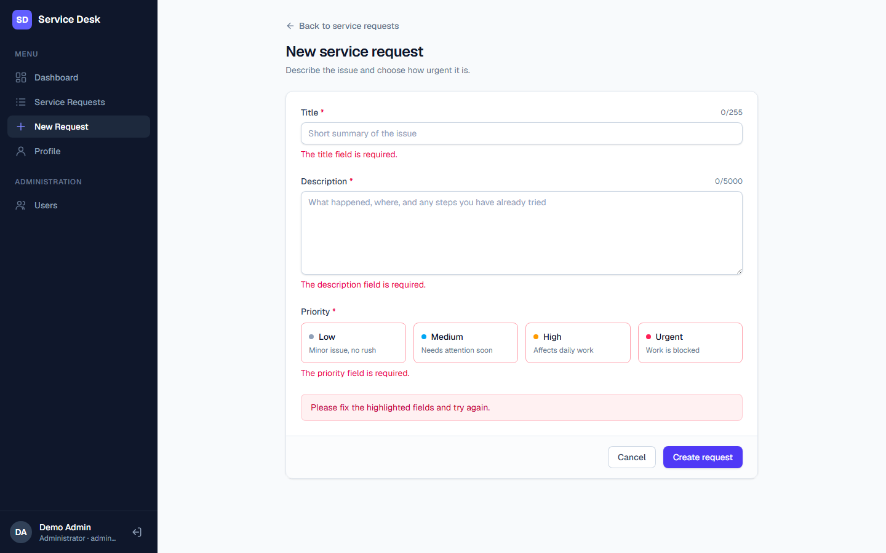
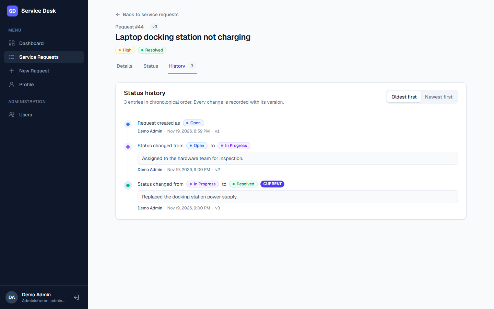
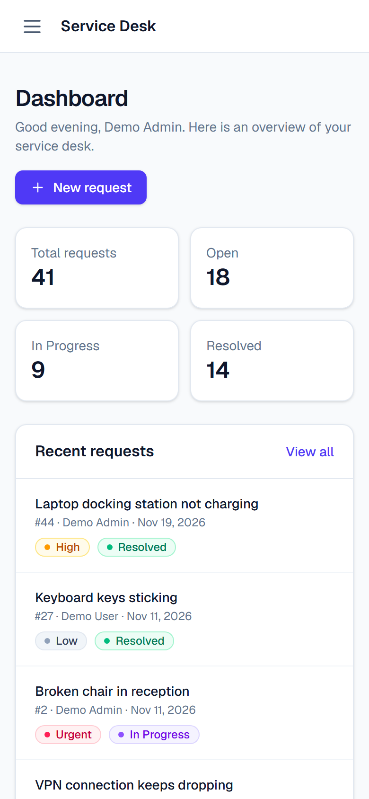
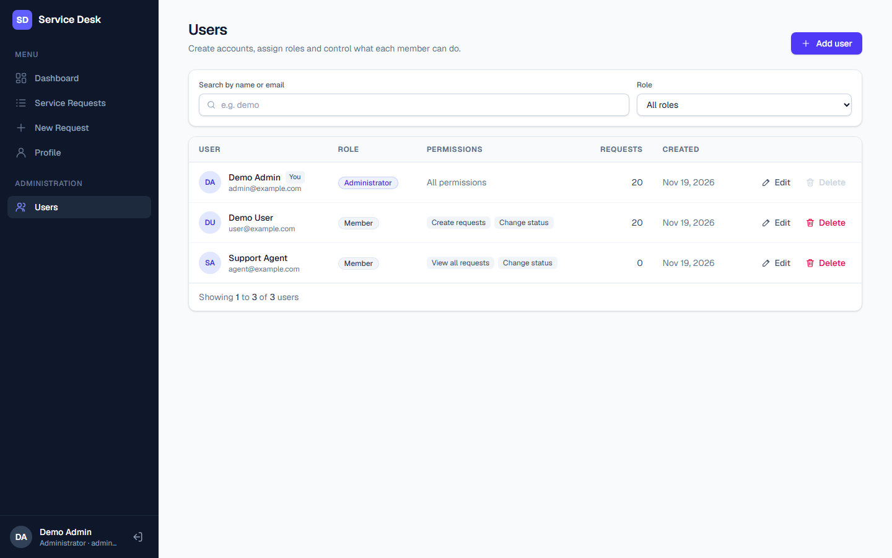
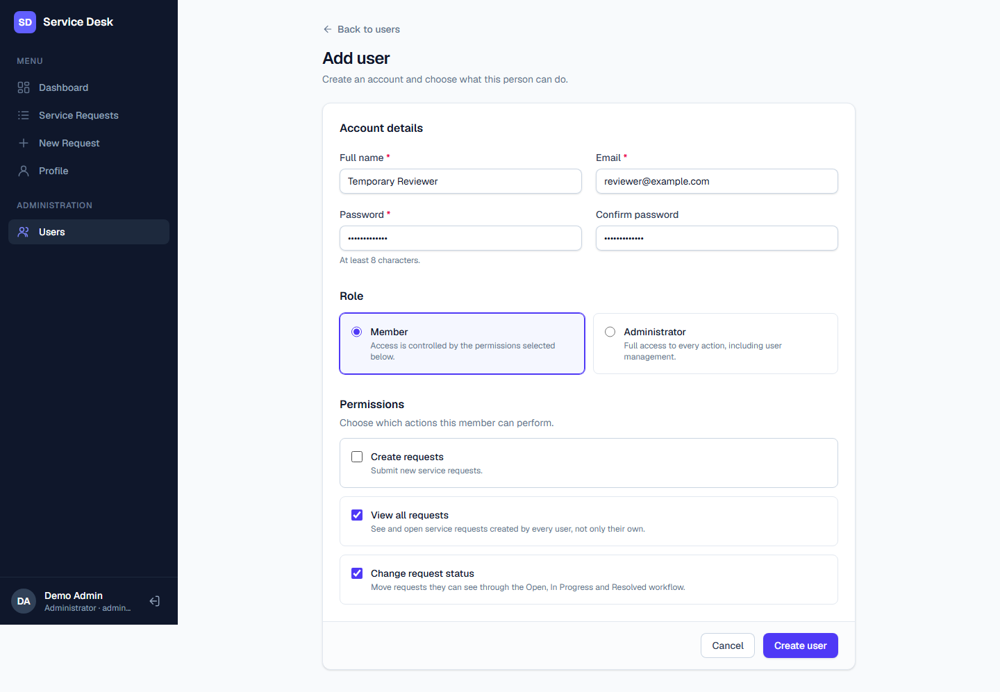
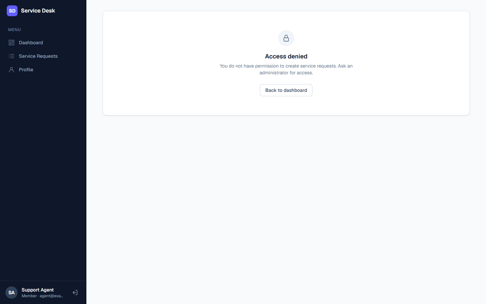

# Service Request Management

A service desk application for logging, tracking and resolving service requests.

- **Backend:** Laravel 13 REST API with Laravel Sanctum token authentication
- **Frontend:** Next.js 16 (App Router, React 19, TypeScript, Tailwind CSS 4) in [`frontend/`](frontend/)
- **Database:** SQLite by default, MySQL or PostgreSQL also supported

## Features

- Login, logout and current user profile with two seeded demo accounts
- Create service requests, view details, search by title, filter by priority and status, server-side pagination
- Status workflow `OPEN → IN_PROGRESS → RESOLVED` with an optional remark on each change
- Audit history: every successful status change creates exactly one history record
- Optimistic concurrency control: every request has a version, and an outdated version can never overwrite newer data
- Access control with roles and permissions: administrators manage everything, members get individual permissions
- User management for administrators: create, edit and delete users and assign roles and permissions

## Project structure

```
app/
  Actions/ChangeServiceRequestStatus.php   status change in a transaction with version check
  Enums/                                   priority, status and permission enums, workflow rules
  Exceptions/                              invalid transition (422) and stale version (409)
  Http/Controllers/Api/                    auth, service request and user endpoints
  Http/Requests/                           validation
  Http/Resources/                          JSON responses
  Models/                                  User, ServiceRequest, ServiceRequestStatusHistory
  Policies/                                service request and user authorization
database/
  factories/  migrations/  seeders/
tests/Feature/                             automated Laravel tests
frontend/                                  Next.js application
docs/screenshots/                          screenshots used below
```

## Requirements

- PHP 8.3 or newer with the `pdo_sqlite` extension (or `pdo_mysql` / `pdo_pgsql`)
- Composer 2
- Node.js 20.9 or newer and npm

## Installation

### 1. Backend (Laravel API)

```bash
git clone https://github.com/GHLakshani/lalan-test.git
cd lalan-test

composer install
cp .env.example .env
php artisan key:generate
```

The default database is SQLite. Create the database file, then run the migrations and seeders:

```bash
touch database/database.sqlite
php artisan migrate --seed
```

To use MySQL instead, update these values in `.env` before migrating:

```dotenv
DB_CONNECTION=mysql
DB_HOST=127.0.0.1
DB_PORT=3306
DB_DATABASE=service_requests
DB_USERNAME=root
DB_PASSWORD=
```

Start the API:

```bash
php artisan serve
```

The API is now available at `http://localhost:8000/api`.

**Running under WAMP or XAMPP:** the project root contains an `.htaccess` and `index.php` that forward requests to `public/`, so the project can also be opened from a web server sub-folder, for example `http://localhost/lalan-test`. The API is then available at `http://localhost/lalan-test/api`.

### 2. Frontend (Next.js)

```bash
cd frontend
cp .env.example .env.local
npm install
```

Set `NEXT_PUBLIC_API_URL` in `frontend/.env.local` to the API address:

```dotenv
NEXT_PUBLIC_API_URL=http://localhost:8000/api
```

Use `http://localhost/lalan-test/api` when the backend runs under WAMP. Then start the frontend:

```bash
npm run dev
```

Open `http://localhost:3000`.

For a production build use `npm run build` followed by `npm run start`.

### Demo accounts

| Account       | Email               | Password   | Role          | Access                                           |
|---------------|---------------------|------------|---------------|--------------------------------------------------|
| Demo Admin    | `admin@example.com` | `password` | Administrator | Everything, including user management            |
| Demo User     | `user@example.com`  | `password` | Member        | Create requests, change status of own requests   |
| Support Agent | `agent@example.com` | `password` | Member        | View all requests and change status, no create   |

The seeders create 20 requests each for Demo Admin and Demo User. Each request moves through the workflow with realistic status history, remarks and versions.

To reset the demo data:

```bash
php artisan migrate:fresh --seed
```

## API

All endpoints return JSON. Send `Accept: application/json`, and `Authorization: Bearer <token>` for protected endpoints.

| Method  | Endpoint                              | Description                                                         |
|---------|---------------------------------------|---------------------------------------------------------------------|
| `POST`  | `/api/login`                          | Returns a token and the user. Rate limited to 6 attempts per minute |
| `POST`  | `/api/logout`                         | Revokes the current token                                           |
| `GET`   | `/api/me`                             | Current user profile                                                |
| `GET`   | `/api/service-requests`               | List with `search`, `priority`, `status`, `per_page`, `page`        |
| `POST`  | `/api/service-requests`               | Create a request (`title`, `description`, `priority`)               |
| `GET`   | `/api/service-requests/{id}`          | Request details with version and status history                     |
| `PATCH` | `/api/service-requests/{id}/status`   | Change status (`status`, `version`, optional `remark`)              |
| `GET`   | `/api/permissions`                    | Available permissions with labels and defaults                      |
| `GET`   | `/api/users`                          | List users with `search`, `role`, `per_page`, `page` (admin only)   |
| `POST`  | `/api/users`                          | Create a user (`name`, `email`, `password`, `password_confirmation`, `role`, `permissions`) |
| `GET`   | `/api/users/{id}`                     | User details (admin only)                                           |
| `PUT`   | `/api/users/{id}`                     | Update a user. `password` is optional (admin only)                  |
| `DELETE`| `/api/users/{id}`                     | Delete a user (admin only)                                          |

Responses for errors:

| Status | Meaning                                                                 |
|--------|-------------------------------------------------------------------------|
| `401`  | Missing or invalid token                                                |
| `403`  | Missing permission, another user's request, or a non-admin managing users |
| `404`  | The request does not exist                                              |
| `409`  | Stale version. The response includes `current_version` and the latest `data` |
| `422`  | Validation error or invalid status transition                           |

## Business rules

**Workflow.** Status can only move one step forward: `open → in_progress → resolved`. Skipping a step, moving backwards, setting the same status again, or changing a resolved request returns `422` with a clear message.

**Audit history.** Creating a request records the initial status. Each successful status change records the previous status, new status, new version, remark, user and time. Failed changes record nothing.

**Concurrency control.** The client sends the `version` it last saw. `ChangeServiceRequestStatus` runs inside a database transaction:

1. Lock the row with `lockForUpdate()` and compare versions. A mismatch returns `409`.
2. Validate the transition. An invalid transition returns `422`.
3. Update with `WHERE id = ? AND version = ?` and increment the version. If no row is updated, another change won the race and `409` is returned.
4. Insert the history record. If this fails, the whole transaction is rolled back.

Direct changes to `status` on the model are blocked, so all status changes go through these rules.

## Roles and permissions

There are two roles:

- **Administrator:** has every permission and is the only role that can manage users.
- **Member:** can only perform the actions an administrator has granted.

| Permission               | Allows                                                                 |
|--------------------------|------------------------------------------------------------------------|
| `requests.create`        | Creating service requests                                              |
| `requests.view_all`      | Seeing and opening every user's requests. Without it, only their own   |
| `requests.change_status` | Changing the status of requests the member can see                     |

New members get `requests.create` and `requests.change_status` by default. Permissions are checked on every API call, so changes take effect immediately. The frontend hides actions the signed-in user is not allowed to perform, and the API enforces the same rules with `403` responses.

User management rules:

- Administrators cannot delete their own account or remove their own administrator role, so the system always keeps at least one administrator.
- Deleting a user is a soft delete. Their tokens are revoked and they can no longer sign in, but their service requests and status history are kept for auditing.

## Running the tests

Backend tests (PHPUnit, in-memory SQLite, no setup needed):

```bash
php artisan test
```

Run a single test file or test:

```bash
php artisan test tests/Feature/ServiceRequestStatusTest.php
php artisan test --filter=test_outdated_version_is_rejected_with_conflict
```

Frontend checks:

```bash
cd frontend
npm run lint
npm run build
```

### Required test cases

The suite contains 86 tests. The required scenarios are covered by:

| Requirement | Tests |
|-------------|-------|
| 1. Successful login and unauthenticated access rejection | `AuthTest::test_user_can_login_with_valid_credentials`, `AuthTest::test_guest_cannot_view_profile`, `ServiceRequestTest::test_guest_cannot_access_service_requests` |
| 2. Preventing users from accessing other users' requests | `ServiceRequestAuthorizationTest::test_user_cannot_view_another_users_request`, `test_user_cannot_change_status_of_another_users_request`, `test_user_only_sees_own_requests_in_the_list` |
| 3. Successful request creation and invalid input validation | `ServiceRequestTest::test_user_can_create_service_request`, `ServiceRequestTest::test_create_validates_input` |
| 4. Successful status transition, version increment and history creation | `ServiceRequestStatusTest::test_status_moves_from_open_to_in_progress`, `test_each_successful_change_creates_exactly_one_history_record` |
| 5. Invalid status transition rejection | `ServiceRequestStatusTest::test_invalid_status_changes_are_rejected` (7 cases: skipping, reversing, repeating and changing after resolved) |
| 6. Stale version update rejection without overwriting newer data | `ServiceRequestStatusTest::test_outdated_version_is_rejected_with_conflict`, `test_two_users_with_the_same_version_only_first_wins`, `test_conditional_update_detects_a_change_made_after_the_version_check` |

User management and permissions are covered by `UserManagementTest` (admin-only access, create, update, validation, self-protection and soft delete) and `PermissionTest` (each permission, immediate permission changes and demo account permissions).

## Screenshots

### Login

| Login | Validation error |
|-------|------------------|
|  |  |

### Request workflow

| Dashboard | Search and filters |
|-----------|--------------------|
|  |  |

| Create request with validation errors | Request details |
|---------------------------------------|-----------------|
|  |  |

| Status management | Status changed |
|-------------------|----------------|
|  |  |

| Stale update rejected | Status history |
|-----------------------|----------------|
|  |  |

| Not found | Mobile dashboard | Mobile menu |
|-----------|------------------|-------------|
|  |  |  |

### User management and permissions

| Users | Add user |
|-------|----------|
|  |  |

| Add user validation | Delete user |
|---------------------|-------------|
|  |  |

| Permission denied for Support Agent |
|-------------------------------------|
|  |

## AI Use & Verification

### AI tools used

- Claude (Anthropic), used through Claude Code in VS Code.

### Parts of the project AI helped with

- **Next.js frontend development:** the screens in `frontend/` (login, dashboard, service request list, create request, request details, status management, history, profile and user management), the sidebar layout, permission-based hiding of actions, the API client, the authentication context, data loading hooks, and handling of loading, empty, validation, authorization, API failure and stale update states.
- **Test data:** the model factories and seeders that create the three demo accounts with their roles and permissions, and 40 demo requests with realistic titles, status histories, remarks and versions.
- **Documentation:** generating this README.

### Example prompt

> "For the ServiceRequest Controller Functions I need a view from Next.js and Need a side bar menu."

This was followed by "note need a dashboard view when loading", which led to the dashboard being the first screen after login and to the layout rendering the sidebar with loading placeholders instead of a blank spinner.

### How the generated code was verified and corrected

- Every change was checked with `npm run lint`, a TypeScript check and `npm run build`.
- Each screen was tested against the running API, including `401`, `403`, `404`, `409` and `422` responses.
- The Next.js development server reported that pages could not be validated for instant navigation, because the generated layout replaced the whole page with a spinner while authentication loaded. The layout was changed to always render the sidebar and page shell with loading placeholders.
- The development server also reported that `usePathname()` was used outside a `<Suspense>` boundary on the request pages. The sidebar links were moved into their own component inside `<Suspense>`.
- The production build failed on the edit user page because `useParams()` was used outside a `<Suspense>` boundary, which lint and the type check did not catch. The page was split into a server page that wraps the client component in `<Suspense>`.
- The screenshots in this README were reviewed and showed three layout problems: the workflow stepper connector extended past the last step, the dashboard cards were cramped on mobile, and the sidebar sections had no spacing between them. All were fixed before the final screenshots were taken.
- The seeded data is checked by `ServiceRequestHistoryTest::test_seeded_requests_have_consistent_history`, which confirms that every seeded request has a complete history, sequential versions and only valid transitions.
- `next dev` automatically generates an `AGENTS.md` file when it detects an AI coding tool. This file was removed and is not part of the repository.

### One technical decision made independently

The brief only asked that users cannot access each other's requests, which a simple owner check would satisfy. I decided that was not enough for a real service desk, because the people who handle requests are usually not the people who create them. A support agent needs to see everyone's requests and move them through the workflow, but should not be able to manage accounts, and a normal staff member should only see their own requests.

So instead of a fixed admin and user split, I chose role and permission based access: administrators have full access and are the only ones who can manage users, while members are given individual permissions (create requests, view all requests, change request status). I also decided that deleting a user should be a soft delete, so their requests and the status history stay intact for auditing, and that an administrator cannot delete or demote their own account, so the system can never be left without an administrator.

The permissions are enforced on the API through Laravel policies, and the frontend only hides actions the user cannot perform, so the backend stays the single source of truth.

